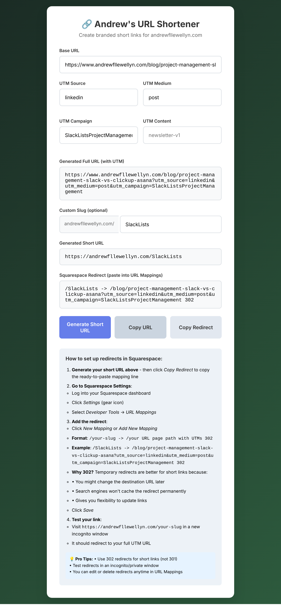

# Andrew's URL Shortener

A simple web-based tool for creating UTM-branded short links for andrewfllewellyn.com instead of using other tools like bit.ly.

**Live app:** https://tangerine-cajeta-ec9200.netlify.app/

## Features

- **Custom Slug Generation**: Create personalized short URLs with custom slugs or auto-generated ones based on your UTM campaign.
- **UTM Parameter Support**: Easily add UTM source, medium, campaign, and content parameters to your links.
- **Copy to Clipboard**: Quickly copy generated URLs for easy sharing.
- **Squarespace Redirect Line**: Copy the exact URL Mapping line, page path and UTMs included, ready to paste into Squarespace.
- **Squarespace Integration**: Built-in instructions for setting up redirects in Squarespace to make your short links functional.

## Usage

1. **Enter Base URL**: Input the original URL you want to shorten in the "Base URL" field.

2. **Add UTM Parameters**: Fill in the UTM fields (Source, Medium, Campaign, Content) to track your marketing efforts.

3. **Customize Slug (Optional)**: Provide a custom slug for your short URL, or leave it blank to auto-generate based on your UTM campaign.

4. **Generate Links**: Click "Generate Short URL" to create both the full UTM URL and the shortened version.

5. **Copy and Use**: Use **Copy URL** to copy the short URL to share, and **Copy Redirect** to copy the Squarespace mapping line.

6. **Set Up Redirect in Squarespace**:
   - Log into your Squarespace dashboard
   - Go to Settings > Developer Tools > URL Mappings
   - Add the redirect:
     - Click New Mapping or Add New Mapping
     - Paste the line from **Copy Redirect**
     - Format: `/your-slug -> /url-with-utms 302`
     - Example:
       ```
       /SlackLists -> /blog/project-management-slack-vs-clickup-asana?utm_source=linkedin&utm_medium=post&utm_campaign=SlackListsProjectManagement 302
       ```
   - Changes go live right away. Test the link in an incognito window

## Screenshots



## License

This project is licensed under the MIT License - see the [LICENSE](LICENSE) file for details.

## Author

Andrew Llewellyn  
GitHub: [afllewellyn](https://github.com/afllewellyn)  
Website: [andrewfllewellyn.com](https://andrewfllewellyn.com)
